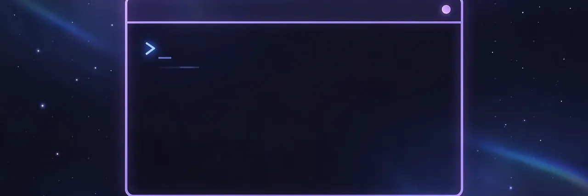

# Hi, I'm Christian

**Linux tinkerer from Germany** — Arch on the desktop, Fedora Silverblue on the ThinkPad. I build my own immutable images with BlueBuild, write small GNOME utilities in Python, Rust and Bash, and maintain user packages for both ecosystems.

---

## Stats

